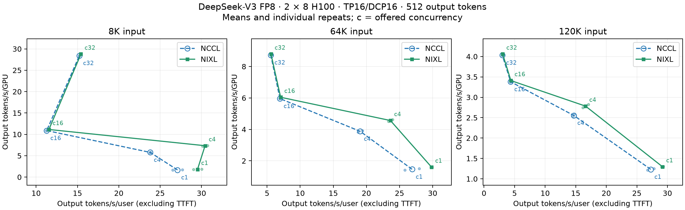
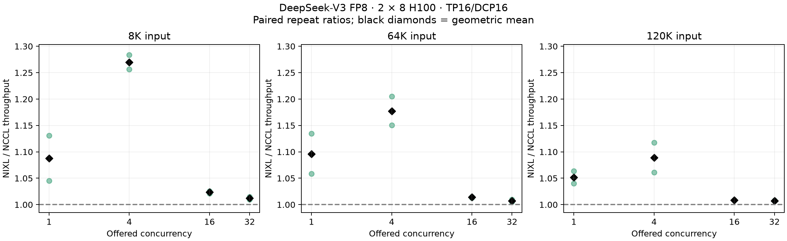
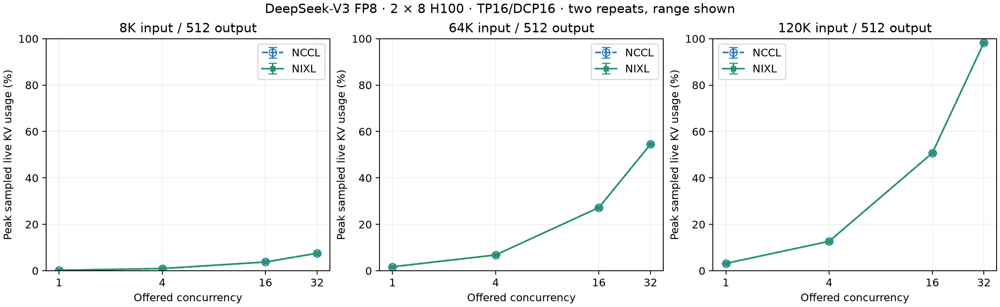

# DeepSeek-V3: NCCL versus mixed NIXL DCP on 16 H100s

Two physical nodes with eight H100 80GB GPUs each; NVLink within each node and InfiniBand/RDMA between nodes. One aggregated server: TP16/DCP16, DP1/PP1/PCP1, expert parallelism enabled. This is DCP output/LSE exchange, not NIXL-EP or prefill/decode disaggregation.

The deployment is motivated by [issue #28476](https://github.com/vllm-project/vllm/issues/28476), which reported a long-context DeepSeek-V3 setup on two H100 nodes with TP16/DCP16. This is a new controlled comparison on current source, not a reproduction of a historical performance result.

Source: [`b1ba99ec247b`](https://github.com/john-evan08/vllm/commit/b1ba99ec247b2c85821b025603740f4062b5082b). Model: [original DeepSeek-V3 native FP8](https://huggingface.co/deepseek-ai/DeepSeek-V3/tree/e815299b0bcbac849fa540c768ef21845365c9eb). BF16 activations/MLA outputs and KV; the fixed DeepGEMM FP8 backend performs its own activation quantization. FlashMLA; piecewise CUDA graphs; no prefix caching, offload, speculative decoding or DBO.

## Results

On this physical pair, the paired throughput increase is 5.2–27.0% at concurrency 1–4 and 0.7–2.3% at concurrency 16–32. These are observations from two repeats, with visible variation at low concurrency; the small high-concurrency differences should not be generalized.

Each plotted point averages two fresh-server runs on the same physical pair; bars show their range, not a confidence interval. Ratios pair corresponding repeats first and then take their geometric mean. All workloads are shown, including any saturation or slowdown.
The trade-off plot also shows individual repeats as faint dots. Both paired ratios are shown in the ratio chart, using the same vertical scale across input lengths.

| Input | Offered concurrency | NCCL output tok/s/GPU | NIXL output tok/s/GPU | Paired throughput ratio | NCCL / NIXL tok/s/user |
| --- | ---: | ---: | ---: | ---: | ---: |
| 8K | 1 | 1.671 | 1.817 | 1.087× | 27.10 / 29.52 |
| 8K | 4 | 5.782 | 7.342 | 1.270× | 23.79 / 30.43 |
| 8K | 16 | 10.885 | 11.140 | 1.023× | 11.28 / 11.55 |
| 8K | 32 | 28.428 | 28.779 | 1.012× | 15.23 / 15.42 |
| 64K | 1 | 1.463 | 1.602 | 1.096× | 26.90 / 29.83 |
| 64K | 4 | 3.876 | 4.564 | 1.177× | 19.06 / 23.63 |
| 64K | 16 | 5.959 | 6.043 | 1.014× | 6.94 / 7.05 |
| 64K | 32 | 8.729 | 8.794 | 1.007× | 5.56 / 5.59 |
| 120K | 1 | 1.233 | 1.297 | 1.052× | 27.27 / 29.19 |
| 120K | 4 | 2.556 | 2.783 | 1.089× | 14.66 / 16.61 |
| 120K | 16 | 3.381 | 3.409 | 1.008× | 4.36 / 4.40 |
| 120K | 32 | 4.032 | 4.061 | 1.007× | 2.99 / 3.05 |

The CSV/JSON include every repeat, median/p95 TTFT and per-request mean TPOT (AIperf ITL), live KV mean/peak/coverage, waiting/running counts and preemptions. Per-request metrics are provided separately. GPU startup memory and persistent workspace capacity are in `runtime-evidence.json`; live KV occupancy is a fraction of the equal KV allocation, not total GPU-memory usage.

## Method and limits

- Frozen synthetic key/value-document prompts: 8K, 64K and 120K rendered tokens; 512 generated tokens with greedy sampling and ignored EOS. Offered concurrency 1/4/16/32; 16/16/64/128 requests per cell. 48 measured cells, 2,688 requests and 1,376,256 generated tokens. This is a controlled serving workload, not a task-accuracy benchmark or production traffic trace.
- Four fresh servers in NCCL/NIXL/NIXL/NCCL order. Reverse the cell order in repeat two. Each cell has an untimed matching-concurrency warmup wave and starts after draining requests/live KV. Registration, checkpoint loading, graph capture, compilation and profiling are outside the measurement. Compilation/capture signatures inside measured log windows fail validation.
- Both arms enable vLLM's existing stack-dump watchdog with a 30-second timeout and 5-second polling interval. It records blocked-thread stacks without resetting the server or changing collective/graph settings. The resolved settings are checked on every worker and included in `runtime-evidence.json`.
- Same image, source, checkpoint/tokenizer revision, fixed request subsets, precision, attention/MoE backends and 16-GiB/rank KV budget. Only `VLLM_USE_NIXL_DCP_A2A=0/1` selects the measured DCP backend. All direct DCP selectors and symmetric-memory all-reduce are disabled in both arms; other collectives still use NCCL. See `study-config.json` for every server flag. NIXL additionally reserves about 6.02 GiB per GPU at this workspace capacity. This comparison holds KV capacity constant; it does not compare each backend's maximum feasible KV allocation.
- NIXL uses mapped writes to seven local peers and `rc_mlx5_gda` device transfers to eight remote peers on every rank. The H100 configuration exposes eight active 400-Gb/s InfiniBand ports per node; this does not assert that every operation uses every rail. Functional tests and model traces verify actual execution.
- The unmodified NCCL baseline retains [value projection before merge for eligible batches](https://github.com/vllm-project/vllm/pull/64994). It can exchange 128-wide values, while this NIXL implementation exchanges 512-wide latent outputs. These results compare complete serving paths, not equal-byte transport primitives.
- [AIperf 0.12.0 metric definitions](https://docs.nvidia.com/aiperf/v0.12.0/reference/ai-perf-metrics-reference): aggregate throughput includes prompt-processing time; per-user interactivity averages each request's inverse ITL and excludes TTFT. Interactivity still includes scheduling pauses and interference from other requests' prefill. Dividing total output throughput by 16 gives throughput/GPU. Latency percentiles describe requests, not individual token stalls.
- KV/scheduler sampling: one second, gaps above 2.5 seconds excluded; minimum measured KV coverage 100.0000%. Offered concurrency need not equal the admitted batch. KV pressure, waiting and preemption are retained; total measured preemptions: 0.
- GPU health screening precedes each allocation; full-run telemetry rejects thermal/hardware slowdown. Two repeats on one pair do not establish across-cluster variability or performance on other models/GPU generations.
- An earlier NCCL timing attempt was excluded after thermal slowdown was observed. Its partial measurements were not pooled with this comparison. The replacement pair passed functional/model qualification plus two consecutive 32-request waves at both 64K and 120K inputs for each backend, with 512 output tokens per request. These untimed sustained-load checks and their full-allocation telemetry are summarized in `preflight-health.json`.
- Another earlier NCCL attempt stalled during the untimed 120K/concurrency-16 warmup and ended with a `sample_tokens` RPC timeout, despite passing hardware telemetry. Its entire partial run is excluded. A fresh short-generation diagnostic passed that warmup and its first repeat; the cause remains unproven. The comparison was restarted with the same numerical/communication controls and the watchdog enabled equally in both arms.

## Correctness qualification

DCP16 functional tests pass exact NCCL-reference comparisons on every rank, four dtype/channel/layout cases, 1,024 changing-input graph replays per case, delayed consumers and the full 16,384-token H8/D512 workspace geometry. See `functional-correctness.json`.

The separately recorded full-model check uses one initialized model and shared communicators, switching standard NCCL → NIXL → standard NCCL. It passes the unchanged numerical gates on 9 sequential 32-token generations (9 exact token sequences; maximum compared logprob delta 0). NCCL restoration is exact. All 61 layer bindings on all 16 ranks and bounded batches of 4/16/32 GPU traces are checked. Inactive NIXL registration remains allocated only in the NCCL correctness arm; no diagnostic reference function is used. See `model-correctness.json`.

The initial fresh-server comparison failed the original numerical gate. Follow-up diagnostics found both NCCL and NIXL reproduce exactly within a server but vary across fresh instances; matching projection order alone did not remove that variation. Those failures are preserved. Single-instance qualification isolates DCP behavior; it is not a general accuracy evaluation. All performance servers use normal standalone backend initialization without switching. Timed requests have identical inputs and fixed output lengths, but generated token identities are not asserted identical; associated MoE routing and fresh-server variation remain limitations.

## Reproduction

Build the source commit using its [NIXL DCP guide](https://github.com/john-evan08/vllm/blob/b1ba99ec247b2c85821b025603740f4062b5082b/docs/design/nixl_dcp.md). Runtime: CUDA toolkit/compiler 13.0.88, Torch 2.14.0+cu130, driver 580.95.05, NCCL 2.30.7 (RAS reports compiled with CUDA 13.3, CUDA runtime 13030 and driver API 13000), NIXL 1.5.0 (`1683cf3b7f3d11674c03c5e861cea22339876c96`), UCX 1.23 (`589be40811c7b53591cbbfe8a3739b5984987cdc`), FlashInfer 0.7.3, Triton 3.8.0 and Transformers 5.20.2. The image/source/config/workload SHA-256 values are in `results.json`; the container artifact itself is not included.

Download the model revision pinned in `study-config.json`. Regenerate prompts with `prepare_workload.py --config study-config.json --model MODEL_DIRECTORY --output DATA_DIRECTORY`, using the tokenizer package versions in `dataset-manifest.json`; verify the manifest's dataset and rendered-token hashes. Start one server across two nodes with the config's `server_args`, `--node-rank`, `--master-addr`, `--master-port` and `--headless` on rank 1. The shared config's environment applies to both arms; explicitly choose the NIXL flag to 0 or 1. Preserve rank placement and exposed GPUs between runs.

Run AIperf 0.12.0 with `--endpoint-type chat --custom-dataset-type single_turn --dataset-sampling-strategy sequential --streaming --use-server-token-count`, seed 42, the pinned repository tokenizer/revision, fixed per-cell request count/concurrency, and `ignore_eos:true`, `temperature:0`, `seed:0`. Select the first request-count records for each cell. The dataset specifies output length 512. Use a node-local mmap cache and keep warmup/profile requests outside timing. Hashes and per-request metrics support checking the published aggregation; private cluster identities, endpoints and storage paths are omitted.

Install the client in a separate Python 3.12 environment with `uv pip install --python .venv/bin/python --require-hashes -r aiperf-0.12.0-py312.lock`; `aiperf-packages.txt` records the installed versions. The client uses Transformers 5.19.0, tokenizers 0.23.3 and huggingface-hub 1.33.0. Its offline resolver requires the entire pinned model repository, including ancillary files; download the complete snapshot before disabling network access. The client tokenizer was checked against the frozen rendered-token hashes. `repository-extras.json` records the additional ancillary-file checks without changing the verified model/tokenizer runtime files.

AI assistance: OpenAI Codex prepared the harness, validation and analysis.
