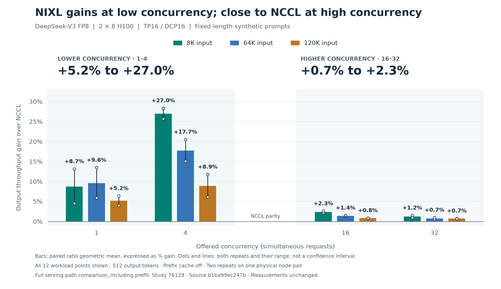
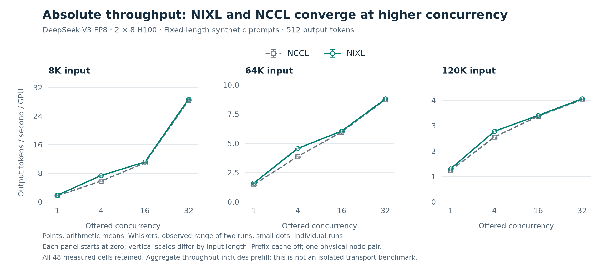

# DeepSeek-V3: a clearer view of the fixed-length results

Presentation refresh of the [published H100 study](https://github.com/john-evan08/vllm/tree/f2a7c963bb7bb2fdacc73089a97165bd64048e97/benchmarks/nixl-dcp-evidence/2026-11-12-deepseek-v3-h100), using its unchanged measurements. No new benchmark was run.

For these fixed-length synthetic workloads, NIXL's observed paired output-throughput gain over NCCL was **5.2–27.0% at concurrency 1–4**, and **0.7–2.3% at concurrency 16–32**. The higher-concurrency measurements are close to parity. These observations cover two repeats on one physical node pair; they do not establish a general advantage across workloads.



[Vector PDF](throughput-gain.pdf) · [SVG](throughput-gain.svg)

The bars show `100 × (sqrt(ratio_repeat_1 × ratio_repeat_2) − 1)`, where each ratio is NIXL output throughput divided by NCCL output throughput for the corresponding repeat. The dots are the two individual repeat gains and the connecting line spans their observed range; it is not a confidence interval. Every one of the 12 workload points is shown on the same percentage scale, with zero indicating NCCL parity.



[Vector PDF](absolute-throughput.pdf) · [SVG](absolute-throughput.svg)

The companion figure shows the arithmetic mean of each backend's two measurements, their observed range and individual runs. Each vertical axis starts at zero; its upper limit differs by input length. Horizontal positions represent the four discrete concurrency settings. All 48 measured cells are retained.

## Scope

- DeepSeek-V3 native FP8, two nodes with eight H100 80GB GPUs each, TP16/DCP16, expert parallelism enabled. Local NVLink and remote InfiniBand/RDMA; the NIXL backend uses mapped writes locally and GPU-initiated puts remotely.
- Fixed synthetic inputs of 8,192 / 65,536 / 122,880 tokens (8K / 64K / 120K), 512 generated tokens, offered concurrency 1 / 4 / 16 / 32, prefix caching disabled. This is the earlier fixed-length experiment, not the later Mooncake trace replay.
- Aggregate output throughput includes prefill. Both backends have the same 16-GiB/rank KV budget; NIXL additionally reserves about 6.02 GiB/rank. The baseline retains projection-before-merge (128-wide values versus NIXL's 512-wide latent outputs), so this compares complete serving paths, not equal-byte transport primitives.
- Source `b1ba99ec247b2c85821b025603740f4062b5082b`, study 76128. See the original report for full configurations, correctness, health, excluded attempts and fresh-server variation. These charts add no task-accuracy or statistical-significance claim.

## Reproduce the figures

Use Python 3.12 and Matplotlib 3.11.2. From this directory in the evidence branch:

```bash
python plot_summary.py --results ../results.csv --reference ../results.json --output regenerated
```

The script verifies the source CSV's SHA-256 (`28e1ef4fc74d227217a6e18554266645b44789641be834a3eb27579c1f3f8d29`), the exact 48 unique measured cells, and all 12 paired means and 24 repeat ratios against the original published JSON. It exports PNG/PDF/SVG figures plus `plotted-values.json`, which contains every plotted value. `validation.json` records the successful check.

AI assistance: OpenAI Codex prepared this presentation and its validation. Original measurements and evidence remain unchanged.
