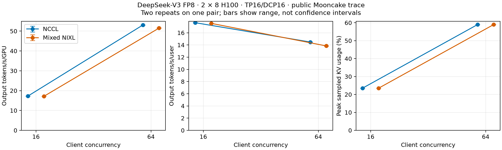

# DeepSeek-V3 public Mooncake replay

| Concurrency | NCCL tok/s/GPU | NIXL tok/s/GPU | Paired NIXL/NCCL | NCCL / NIXL tok/s/user |
| ---: | ---: | ---: | ---: | ---: |
| 16 | 17.266 | 17.182 | 0.995× | 17.65 / 17.54 |
| 64 | 53.083 | 51.521 | 0.971× | 14.48 / 13.84 |

Each cell replays all 3,250 retained requests, with prefix caching enabled and cleared after warmup. Two repeats/backend, one physical pair, identical fixed 16-GiB/rank KV budget. NIXL additionally reserves approximately 6.02 GiB/rank. Other collectives use NCCL. NCCL retains projection before merge; this is a full serving-path comparison, not equal-byte transport timing. Interactivity excludes TTFT; aggregate throughput includes prefill. Full per-repeat cache-hit rates, KV coverage, preemptions and latency are in results.csv. This length/prefix-sharing replay is not a semantic model evaluation or a reproduction of the blog hardware/model. Previous synthetic results are a separate study.
